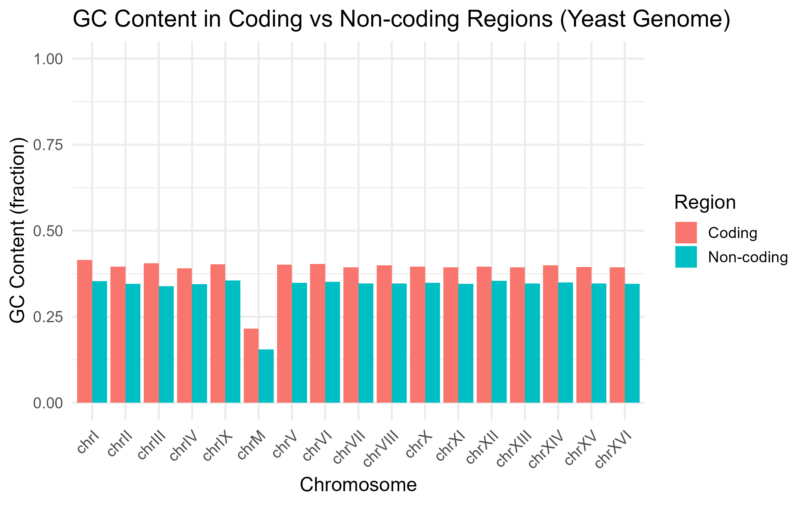
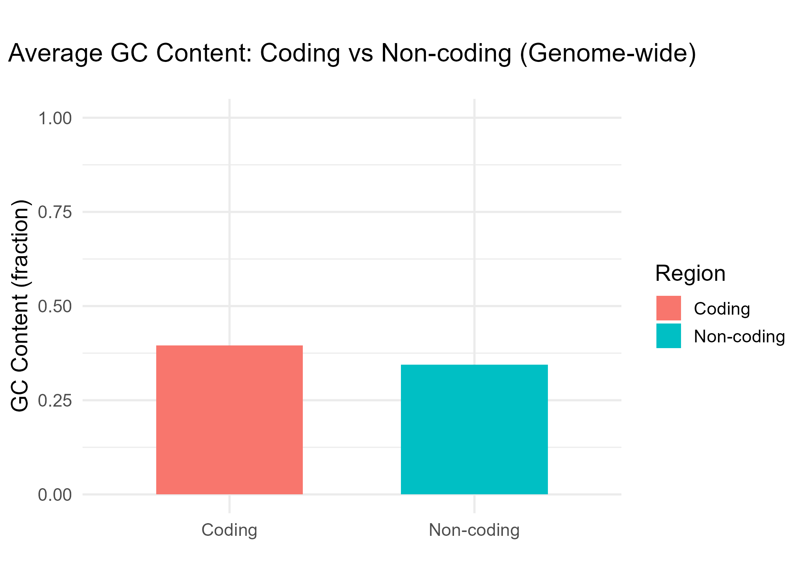
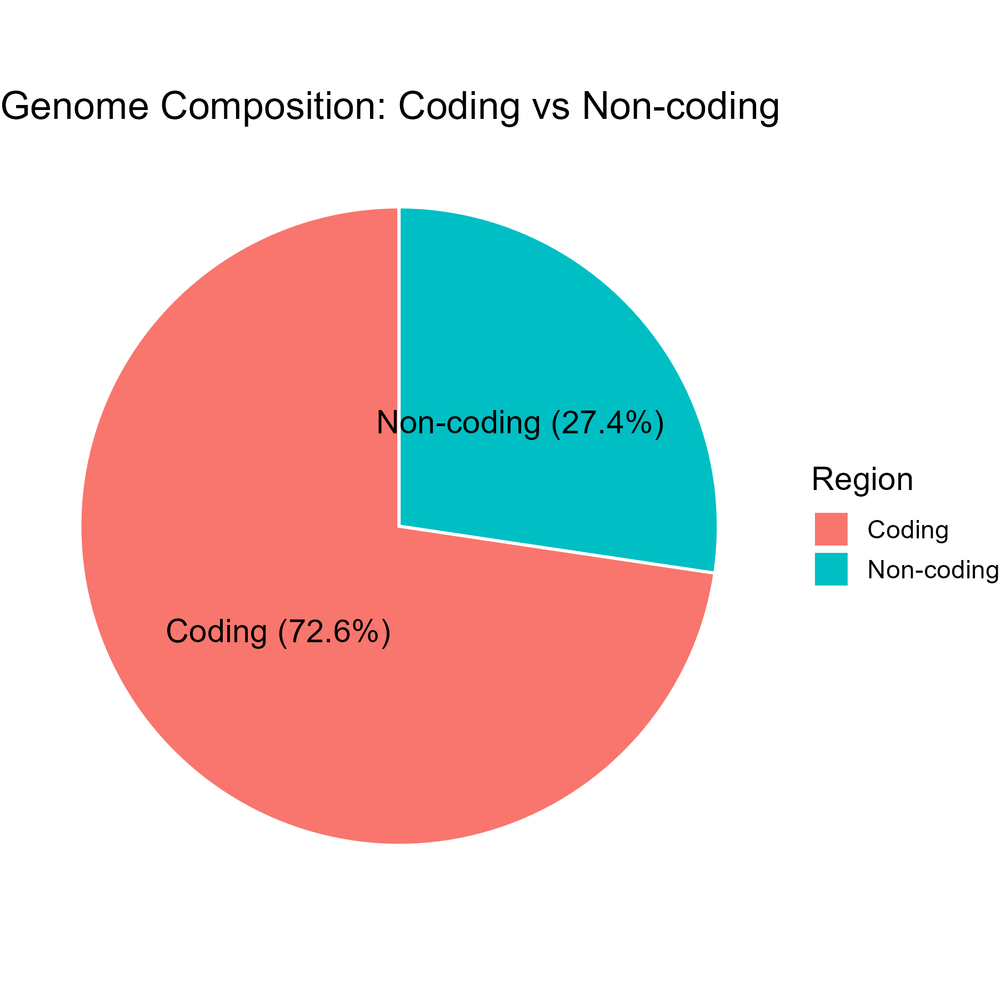

# 🧬 Yeast Genome Analysis

Analysis of the *Saccharomyces cerevisiae* (baker's yeast) genome in R and Bioconductor: how much of the genome codes for protein, and whether coding and non-coding DNA differ in GC content. This was my first independent genomics project.

📝 **Blog post:** [My First Genome Project, and the Bug I Found a Year Later](https://mdabrarfaiyaj.github.io/posts/My-First-Genome-Project-and-the-Bug-I-Found-a-Year-Later/)

---

## ⚠️ Correction (October 2026)

The first version of this analysis (October 2025) contained a bug. The chromosome range had no strand (`*`), while the coding regions (CDS) were stranded (`+`/`-`). `setdiff()` therefore removed nothing, and **"non-coding" was the entire chromosome**. As a result, the first version reported:

- coding DNA as **42.5%** of the genome, which is wrong (the true value is roughly **70%**, consistent with yeast being a gene-dense genome), and
- "non-coding" GC content that was really the GC content of whole chromosomes.

**The fix** (now in `yeast_genome_analysis.R`):

```r
# before: strands don't match, so nothing is subtracted
cds_chr_merged <- reduce(cds_chr)

# after: a base is coding if a gene covers it on either strand
cds_chr_merged <- reduce(cds_chr, ignore.strand = TRUE)
```

GC content is also now weighted by length (total G+C divided by total bases) instead of averaging segments of very different sizes. The results and figures in `results/` are produced by the corrected script.

---

## Features

- Extract coding (CDS) and non-coding regions per chromosome from the sacCer3 annotation
- Compute base-weighted GC content for each region
- Save results as CSV and plots:
  - GC content per chromosome
  - Genome-wide GC content
  - Genome composition (coding vs. non-coding)

## Output files

| File | Content |
|---|---|
| `results/yeast_coding_vs_noncoding_all_chr.csv` | Bases and GC content per chromosome and region |
| `results/GCcontent_per_chromosome.png` | GC content of coding vs. non-coding DNA per chromosome |
| `results/GCcontent_genomewide.png` | Genome-wide GC content by region |
| `results/genome_composition_pie.png` | Share of the genome that is coding vs. non-coding |

## Results





- **Coding DNA makes up roughly 70% of the yeast genome** (exact value in `genome_composition_pie.png`). Yeast genes are packed closely together, with short spaces between them.
- **Coding DNA is GC-richer than non-coding DNA** on every nuclear chromosome (coding ≈ 40% GC). This fits the known pattern in yeast, where genes tend to have higher GC content than the DNA between them.
- **The mitochondrial chromosome (chrM)** has very low GC content (well under 25%), reflecting its separate evolutionary history.

## Lessons learned

- **Strand matters** in GenomicRanges. Mixing stranded and unstranded ranges can silently give wrong results.
- **Check numbers against known biology.** "Only 42.5% coding" should have been a warning sign for a gene-dense genome like yeast.
- **Inspect the raw table, not only the plots.** The bug was visible as a "non-coding" length equal to the full chromosome length.

## Run it

```r
if (!require("BiocManager")) install.packages("BiocManager")
BiocManager::install(c("BSgenome.Scerevisiae.UCSC.sacCer3",
                       "TxDb.Scerevisiae.UCSC.sacCer3.sgdGene",
                       "GenomicRanges", "Biostrings"))
install.packages(c("ggplot2", "dplyr"))
source("yeast_genome_analysis.R")
```

## References

1. Goffeau A, Barrell BG, Bussey H, et al. (1996). Life with 6000 genes. *Science* 274(5287): 546–567.
2. Lawrence M, Huber W, Pagès H, et al. (2013). Software for computing and annotating genomic ranges. *PLOS Computational Biology* 9(8): e1003118.

---

**Author:** Md. Abrar Faiyaj · [Website](https://mdabrarfaiyaj.github.io/) · [GitHub](https://github.com/mdabrarfaiyaj)

📌 Licence: MIT. Please credit Md. Abrar Faiyaj if reused.
